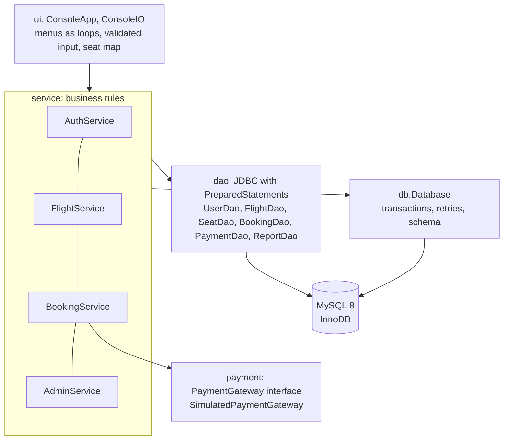
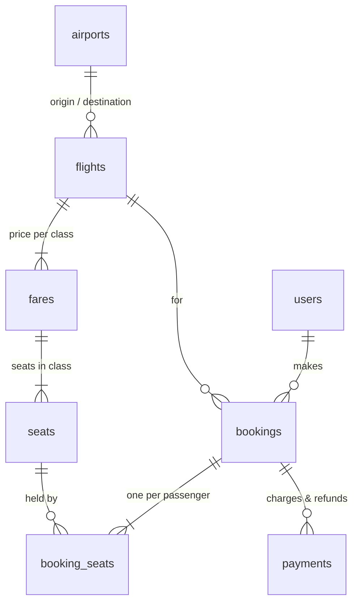

# ARMS: Airline Reservation Management System

[](https://github.com/k-ishan-9/airline-seat-reservation-and-management/actions/workflows/ci.yml)

A seat-booking system in **Java 21, JDBC and MySQL 8** that can't double-book a seat, even under concurrent load. Customers search flights, pick seats on a cabin map, pay by card or UPI, and cancel with a time-based refund. Admins schedule and cancel flights and see occupancy and revenue reports. Bookings use explicit transactions with rollback, row-level locking, short seat holds during payment, and a database constraint as the final guarantee. 46 automated tests, including concurrency tests, run against a real MySQL in CI.

---

## Features

**Customers**
- Register and log in (PBKDF2-hashed passwords; account locked for 15 minutes after 5 failed attempts)
- Search flights by route and date, with live seats left per class; or find the cheapest flights within a budget
- Cabin seat map (First and Business 2+2, Economy 3+3), choose seats or auto-assign, up to 6 passengers
- Pay by card (Luhn-checked) or UPI through a payment gateway interface; 6-character PNR
- My bookings, and cancellation with a refund policy: 90% (72 h+), 50% (24–72 h), 0% (under 24 h)

**Admins**
- Add a flight (fares and all 144 seats are created in one transaction)
- Cancel a flight: every passenger refunded 100%, all-or-nothing
- Reports: load factor of upcoming flights, and revenue by route (charges minus refunds)

---

## How double booking is prevented

| Layer | Mechanism |
| --- | --- |
| 1. Row locks | `SELECT ... FOR UPDATE` on the chosen seat rows, in `seat_id` order (consistent lock order avoids deadlocks) |
| 2. Auto-assign under load | `FOR UPDATE SKIP LOCKED`: concurrent bookings take different free seats instead of queueing |
| 3. Database guarantee | `UNIQUE (seat_id, active)` on `booking_seats`: at most one active holder per seat, whatever the code does |
| 4. Seat holds | Seats are HELD for 10 minutes while paying; no lock is held during the payment call; expired holds are released lazily |
| 5. Transactions | `Database.inTransaction` commits or rolls back as a unit and retries deadlock victims with jittered back-off |

Proven by tests: 20 threads booking the same seat produce exactly 1 confirmation and 19 "seat taken" errors; 12 threads auto-booking an 8-seat cabin sell exactly 8 distinct seats.

---

## Architecture



The UI never touches SQL, and DAOs never decide business rules. Services receive their dependencies (database, clock, payment gateway) through constructors, wired once in `App.java`, so tests can swap in a fake clock or a slow payment provider.

## Database schema (3NF)



Key decisions: a booking's total is `SUM(booking_seats.price)`, never stored twice; `price` on `booking_seats` is a snapshot of the fare at booking time; money is `DECIMAL(10,2)` and `BigDecimal`, never `double`; card numbers are never stored (only `CARD ****1111`). Constraints include foreign keys, `CHECK (origin <> destination)`, `CHECK (arrival_time > departure_time)`, `UNIQUE (flight_no, departure_time)` and `UNIQUE (pnr)`.

---

## Run it

You need **JDK 21+** and **MySQL 8**. The easiest way to get MySQL is Docker.

```bash
docker compose up -d mysql      # MySQL 8.4 with database "arms" and user "arms"
./run.sh                        # Windows: run.bat   (compiles with javac, no Maven needed)
```

On first start ARMS creates the tables, demo flights for the next 14 days, and an `admin` account (password `Admin@12345`, set by `ARMS_ADMIN_PASSWORD`).

Other ways to run it:
- **Maven:** `mvn package`, then `java -jar target/arms.jar`
- **All in Docker:** `docker compose run --rm app`

Test payment details: card `4111 1111 1111 1111` is approved, `4000 0000 0000 0002` is declined, and any UPI ID like `name@okbank` works.

### Configuration

Set environment variables (defaults in `src/main/resources/arms.properties`): `ARMS_DB_URL`, `ARMS_DB_USER`, `ARMS_DB_PASSWORD`, `ARMS_HOLD_MINUTES` (10), `ARMS_HASH_ITERATIONS` (600000), `ARMS_ADMIN_PASSWORD`.

---

## Tests

```bash
mvn verify    # 46 tests; needs MySQL. Uses ARMS_TEST_DB_URL / _USER / _PASSWORD
```

By default the tests use `jdbc:mysql://localhost:3306/arms_test` as `root`/`root` (the Docker MySQL). They refuse to run unless the database name ends in `_test`, and each test starts from an empty schema.

| Area | What's proven |
| --- | --- |
| Concurrency | One winner out of 20 simultaneous bookings of a seat; no overselling with 12 auto-assign threads on 8 seats; a direct SQL insert of a second active holder is rejected by the unique key |
| Seat holds | Payment slower than the hold is refunded and the seat released; an abandoned hold is reclaimed by the next customer |
| Booking rules | Chosen and auto-assigned seats, wrong-class and non-existent seats, invalid names, booking closes 60 minutes before departure, declined payment releases seats |
| Cancellation | 90 / 50 / 0% refund boundaries, seats freed, refund recorded, no double cancel, other customers' PNRs return "not found" |
| Accounts | Validation, duplicate usernames, identical errors for a wrong user or password, lockout and unlock after 15 minutes |
| Admin | Role enforcement, a new flight gets 144 seats, flight cancellation refunds everyone, reports match charges and refunds |
| Units | Refund policy, PBKDF2 hashing, PNR format, cabin layout, Luhn check, masking |

GitHub Actions runs `mvn verify` against a MySQL 8.4 service container on every push.

---

## Project structure

```
src/main/java/com/arms/
  App.java                 wires everything together
  config/AppConfig.java    properties + environment variables
  db/Database.java         connections, transactions with rollback and deadlock retry, schema setup
  model/                   records: Flight, Seat, Booking, FareClass, BookingStatus, User...
  dao/                     JDBC: users, flights, seats (locking reads), bookings, payments, reports
  service/                 AuthService, FlightService, BookingService, AdminService, DataSeeder
  payment/                 PaymentGateway interface, sealed PaymentMethod, SimulatedPaymentGateway
  ui/                      ConsoleApp (menus), ConsoleIO (validated input, hidden passwords)
  util/                    PasswordHasher (PBKDF2), PnrGenerator, RefundPolicy, SeatLayout
src/main/resources/db/schema.sql
src/test/java/com/arms/    unit tests + integration tests against MySQL
```
